<p align="center">
  
</p>

# 🧮 Basic_Codes

A collection of beginner **C** programs: loops, conditionals, patterns and small math problems. Each one lives in its own folder as a Code::Blocks project with a single `main.c`.

## Programs

| # | Problem |
|---|---|
| 1 | [C program using if-else and sentinel-controlled “for” repetition statement](C/C%20program%20using%20if-else%20and%20sentinel-controlled%20%E2%80%9Cfor%E2%80%9D%20repetition%20statement/) |
| 2 | [C to print shape](C/C%20to%20print%20shape/) |
| 3 | [Calculate the distance between two points](C/Calculate%20the%20distance%20between%20two%20points/) |
| 4 | [Calculate the smallest possible number of notes and coins](C/Calculate%20the%20smallest%20possible%20number%20of%20notes%20and%20coins/) |
| 5 | [Factorial using for loop](C/Factorial%20using%20for%20loop/) |
| 6 | [Find how many times an integer number can be divided by Two](C/Find%20how%20many%20times%20an%20integer%20number%20can%20be%20divided%20by%20Two/) |
| 7 | [Find out the average of the given numbers, -1 terminate usnig for loop](C/Find%20out%20the%20average%20of%20the%20given%20numbers%2C%20-1%20terminate%20usnig%20for%20loop/) |
| 8 | [Find the summation of all the digits usnig while loop](C/Find%20the%20summation%20of%20all%20the%20digits%20usnig%20while%20loop/) |
| 9 | [Generate a grade report based on the number given by the user](C/Generate%20a%20grade%20report%20based%20on%20the%20number%20given%20by%20the%20user/) |
| 10 | [Generate the multiplication table using while loop](C/Generate%20the%20multiplication%20table%20using%20while%20loop/) |
| 11 | [N expressed as sum of 4 prime numbers](C/N%20expressed%20as%20sum%20of%204%20prime%20numbers/) |
| 12 | [N. N  2 lines must be printed](C/N.%20N%20%202%20lines%20must%20be%20printed/) |
| 13 | [Pattern using nested while loops](C/Pattern%20using%20nested%20while%20loops/) |
| 14 | [Print Hello World 10 times along with the serial number and skip the 7th Hello World using while loop](C/Print%20Hello%20World%2010%20times%20along%20with%20the%20serial%20number%20and%20skip%20the%207th%20Hello%20World%20using%20while%20loop/) |
| 15 | [Print odd numbers between 1 and 50 in reverse order using while loop](C/Print%20odd%20numbers%20between%201%20and%2050%20in%20reverse%20order%20using%20while%20loop/) |
| 16 | [S = 1 + 32 + 54 +78 + ... + 39 using while loop](C/S%20%3D%201%20%2B%2032%20%2B%2054%20%2B78%20%2B%20...%20%2B%2039%20using%20while%20loop/) |
| 17 | [Shape having the number of rows input by the user](C/Shape%20having%20the%20number%20of%20rows%20input%20by%20the%20user/) |
| 18 | [Then calculate the difference between the Highest and Lowest number using while loop](C/Then%20calculate%20the%20difference%20between%20the%20Highest%20and%20Lowest%20number%20using%20while%20loop/) |
| 19 | [Two integer values X and Y as inputs and determines which quadrant the point lies](C/Two%20integer%20values%20X%20and%20Y%20as%20inputs%20and%20determines%20which%20quadrant%20the%20point%20lies/) |
| 20 | [X to the power Y using while loop](C/X%20to%20the%20power%20Y%20using%20while%20loop/) |

## Run a program

Open the folder's `.cbp` file in **Code::Blocks**, or compile `main.c` directly:

```bash
cd "C/Factorial using for loop"
gcc main.c -o main
./main
```

On Windows, run `main.exe` instead of `./main`.
